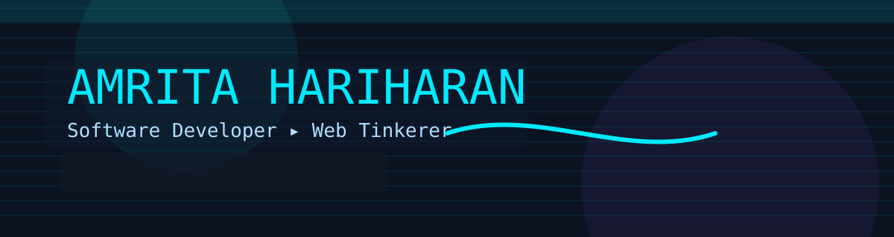

<!--
  Amrita Hariharan | GitHub Profile
  A clean, vibrant developer profile with an emphasis on engineering, creativity and building useful things.
-->

  

   

  
  

    

  

---

## ✦ A little about me

I'm a **Computer Science & Engineering student at SRM Institute of Science and Technology**, interested in the space where software, AI and creativity meet.

I enjoy turning ideas into working products — from designing interfaces and building full-stack applications to exploring intelligent systems and experimenting with new technologies. I’m equally excited by the engineering behind a product and the experience people have while using it.

- 🎓 **Studying:** B.Tech — Computer Science & Engineering
- 💻 **Interests:** Software Engineering · Artificial Intelligence · Full-Stack Development
- 🧠 **Exploring:** Machine Learning, product thinking and scalable applications
- 🚀 **I enjoy:** Building projects, collaborating with people and learning by doing
- 📫 **Reach me:** [Email](mailto:amrita.hariharan2006@gmail.com)

---

## 🧰 My toolkit

  **Languages**

  

    

  **Development & Frameworks**

  

    

  **Data & Tools**

  

---

## 🚀 Things I've been building

A few areas I enjoy working in:

| Area | What I like exploring |
| --- | --- |
| **AI & Intelligent Systems** | Applying machine learning and AI to practical problems |
| **Full-Stack Development** | Creating complete applications, from intuitive interfaces to reliable APIs |
| **Product Engineering** | Turning user needs into features, workflows and usable products |
| **Creative Technology** | Combining design, storytelling and technology to make experiences memorable |

---

## 📊 GitHub at a glance

  

    

  
  

    

  

---

## 🌱 Outside the code editor

I'm someone who loves exploring new places, discovering good food, meeting people and finding inspiration in unexpected places. I’m interested in fashion, content creation and the creative side of building a brand, too.

I believe the best work happens when **curiosity meets consistency**.

---

  ### Thanks for stopping by! ✨

  **Have an idea, a project or just want to talk tech? Let's connect.**

  

    

  

   

  “Stay curious. Keep building. Make it meaningful.”

